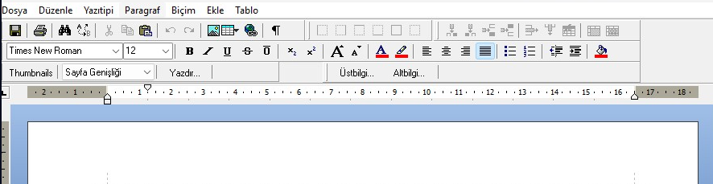
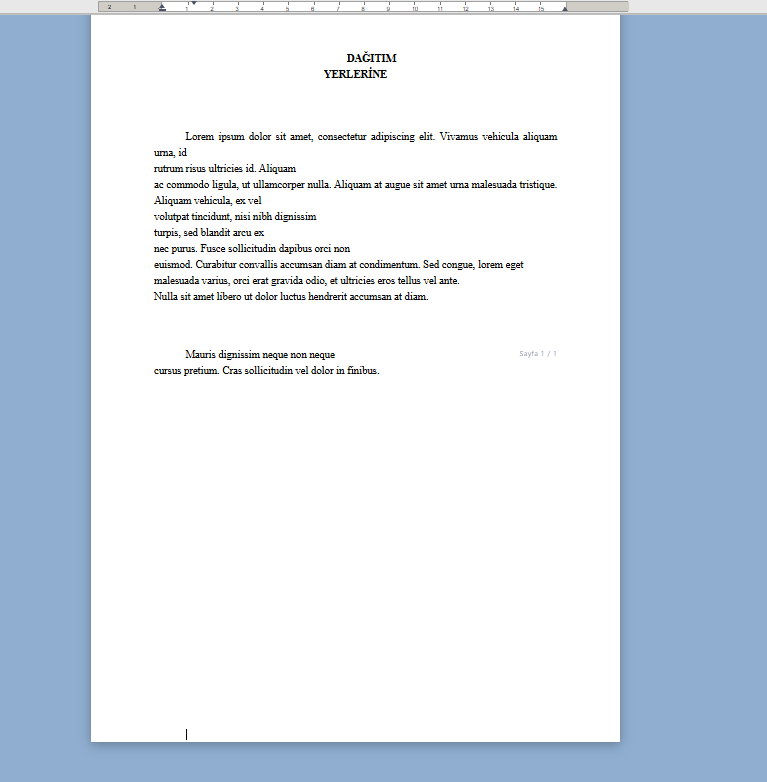
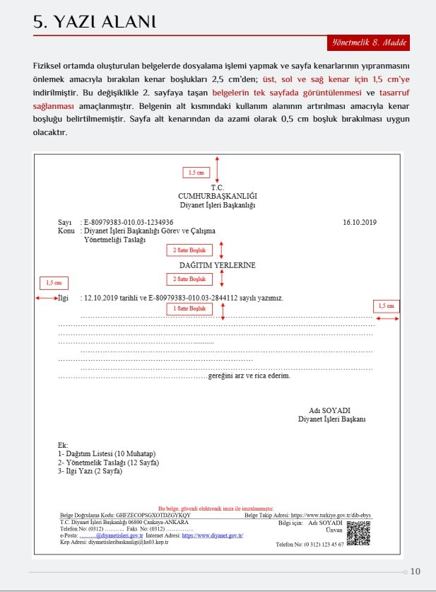

# 🖋️ OldStyle Web Text Editor

[](LICENSE)
[](https://www.typescriptlang.org/)
[](https://vitejs.dev/)
[](#)
[](#-ckeditor-4-soketleme-adaptörü-drop-in-shim)
[](docs/KENDO_UI_MIGRATION_GUIDE.md)

**OldStyle Web Text Editor**, kurumsal web uygulamaları, Kendo UI arayüzleri, kamu/belediye EBYS (Elektronik Belge Yönetim Sistemi) ve modern SPA projeleri için tasarlanmış; **CKEditor 4 yerine doğrudan (drop-in) takılabilen**, gerçek **A4 kağıt sayfalamalı**, Microsoft Word (.docx) uyumlu yüksek sadakatli zengin metin editörüdür.

---

## 📸 Görsel Tanıtım (Screenshots & Showcase)

<div align="center">

### 🎗️ 1. Modern Word Şeridi (Ribbon), Menü Çubuğu ve İnteraktif Cetvel
*Tam teşekküllü üst menü çubuğu, EBYS/UYAP disket ve yazdırma araçları, serbest tablo ızgarası, biçimlendirme araçları, görünüm/küçük resimler kontrolü ve 1.25 cm ilk satır girintisini dinamik gösteren akıllı yatay cetvel.*



<br/>

### 📄 2. Gerçek Fiziksel Çok Sayfalı A4 Kağıt Motoru & Resmi Yazı Düzeni
*210 × 297 mm gerçek A4 boyutlandırması, T.C. Cumhurbaşkanlığı 2025 Yönetmeliği (8. Madde) ile tam uyumlu 1.5 cm kenar boşlukları, 18 cm yazı alanı, iki yana yaslı 1.25 cm paragraflar, kurumsal tablolar ve e-imza blokları.*



<br/>

### 🏛️ 3. T.C. Cumhurbaşkanlığı 2025 Resmî Yazışma Yönetmeliği (8. Madde) Standartları
*Yönetmelikte belirtilen 1.5 cm üst/sol/sağ, 0.5 cm alt boşluk ve Times New Roman 1.15 satır aralığı standartlarının teknik doğrulaması.*



</div>

---

## 🌟 Neden OldStyle Web Text Editor?

Geleneksel web editörleri (CKEditor, TinyMCE, Quill vb.) metni aşağıya doğru sonsuz uzayan tek bir pencerede gösterir. Kullanıcı yazının gerçekte kaç sayfa olduğunu, sayfa sonlarının nereye denk geldiğini ve Word'e aktarıldığında nasıl görüneceğini tahmin edemez.

**OldStyle Web Text Editor**, web tarayıcınızı tam teşekküllü bir masaüstü Word işlemcisine dönüştürür:
- **Gerçek Çok Sayfalı A4 Motoru:** Yazı 1. sayfayı aştığında otomatik olarak 2. ve 3. fiziksel A4 sayfası açılır; silindiğinde sayfalar geri toplanır.
- **CKEditor 4 Soketleme Adaptörü:** `window.CKEDITOR.replace(...)` ve `$('#txtMetin').ckeditor()` çağrılarını sıfır kod değişikliğiyle karşılar.
- **Word (.docx OpenXML) İçe ve Dışa Aktarım:** Dahili motoru ile Word belgelerini format kaybetmeden açar ve doğrudan `.docx` olarak indirir.
- **2025 Cumhurbaşkanlığı Resmî Yazışma Standartları:** 1.5 cm / 0.5 cm kenar boşlukları, 18 cm gövde alanı, 1.15 satır aralığı ve bağımsız satır hizalama cetveli varsayılan olarak gelir.
- **Sıfır Dış Bağımlılık:** React, Vue veya harici ağır kütüphaneler gerektirmez; tek bir CSS ve JS dosyasıyla çalışır.

---

## 🚀 Hızlı Başlangıç (Quick Start)

### 1) Kütüphaneyi Sayfanıza Ekleyin:

```html
<!-- Editör Stilleri -->
<link rel="stylesheet" href="dist/oldstyle-web-texteditor.css">

<!-- Editör Motoru ve CKEditor Soket Adaptörü -->
<script src="dist/oldstyle-web-texteditor.umd.js"></script>
```

---

### 2) CKEditor 4 Yerine Doğrudan Kullanım (Drop-in):

Mevcut projenizde hiçbir JavaScript kodunu değiştirmenize gerek yoktur:

```javascript
// Klasik CKEditor 4 API'si aynen çalışır:
CKEDITOR.replace('txtBelge', {
    height: 500,
    fontFamily: 'Times New Roman',
    fontSize: '12pt'
});

// Veri okuma:
var html = CKEDITOR.instances['txtBelge'].getData();

// Veri yazma:
CKEDITOR.instances['txtBelge'].setData('<p>Resmi yazı metni...</p>');
```

---

### 3) jQuery / Metronic / Kendo UI Adaptör Kullanımı:

```javascript
// jQuery eklentisi olarak:
$('#txtBelge').ckeditor(function() {
    console.log('Editör hazır!');
});

// $.valHooks sayesinde form okuma/yazma otomatik senkronizedir:
var icerik = $('#txtBelge').val();       // getData() çalışır
$('#txtBelge').val('<p>Yeni Metin</p>');  // setData() çalışır
```

---

### 4) Bağımsız Modern API Kullanımı:

```javascript
// Sayfa içi gömülü editör:
const editor = new OldStyleWebTextEditor('#editorContainer', {
    placeholder: 'Resmi yazınızı buraya yazın...',
    lineHeight: '1.15',
    pageMargin: '1.5cm 1.5cm 0.5cm 1.5cm'
});

editor.on('change', () => {
    console.log('Güncel içerik:', editor.getData());
});
```

---

### 5) Tam Ekran Modal (Word Pop-up) Modu:

```javascript
OldStyleWebTextEditor.createModal({
    trigger: '#btnDuzenle',           // Açılış butonu
    preview: '#onizlemeKutusu',       // Önizleme alanı
    title: 'T.C. Resmi Yazışma Belgesi',
    onSave: function(html) {
        console.log('Kaydedilen HTML:', html);
    }
});
```

---

## 🔌 CKEditor 4 Soketleme Adaptörü (Drop-in Shim)

OldStyle Web Text Editor, bünyesinde yer alan `CKEditorShim` katmanı ile Kendo UI, Metronic ve Olgu EBYS gibi büyük kurumsal sistemlere tam uyum sağlar:

- **`window.CKEDITOR`:** `replace`, `appendTo`, `inline`, `instances`, `on`, `fire`, `tools` fonksiyonlarını karşılar.
- **`registerJQueryAdapter($)`:** `$.fn.ckeditor`, `$.fn.ckeditorGet` ve `$.valHooks.textarea` kancalarını entegre eder. Form serialize işlemlerinde veya `$(el).val()` çağrılarında veri kaybı yaşanmaz.
- **RequireJS / AMD Desteği:** `require(['ckeditor'])` ve `require(['ckeditor-core'])` modüllerini otomatik karşılar.

👉 **Detaylı Kendo UI & EBYS Kurulum ve Entegrasyon Kılavuzu için:**  
📘 **[docs/KENDO_UI_MIGRATION_GUIDE.md](docs/KENDO_UI_MIGRATION_GUIDE.md)** dosyasını inceleyin.

---

## 💎 Temel Özellikler Detayı

### 1. Gerçek A4 Fiziksel Sayfalama & Akış Motoru
- Metin 1. sayfayı doldurduğunda otomatik olarak 2. sayfaya taşar.
- Manuel Sayfa Sonu (`Ctrl + Enter` veya Page Break butonu) desteği.
- İçerik silindiğinde geriye doğru akış (backward reflow) ve boşalan sayfaların otomatik temizlenmesi.
- Her sayfanın altında "Sayfa X / Y" rozeti.

### 2. İnteraktif Satır Bazlı Cetvel (Ruler Bar)
- T.C. Cumhurbaşkanlığı 2025 Kılavuzuna uygun **18 cm yazı alanı** ve **1.5 cm kenar boşlukları**.
- Her satırın hizasını ayrı ayrı gösteren bağımsız çentikler (S1, S2, S3...).
- İmlecin bulunduğu satırın boşluk/girinti değerini milimetrik olarak gösteren rozet.

### 3. Serbest Kenarlıksız ve Kenarlıklı Tablo Sistemi
- Word / CKEditor tarzı fare ile seçilen 8x8 interaktif tablo ekleme.
- Tablo üzerinde yüzen yönetim kolu: ✥ Taşı/Seç, ⊞ Kenarlıklı/Kenarlıksız Geçiş, ⬇️ Satır Ekle, ➡️ Sütun Ekle, 🗑️ Tabloyu Sil.
- Fare ile sütun genişliği (`col-resize`) ve satır yüksekliği (`row-resize`) ayarlama.

### 4. Microsoft Word (.docx) & HTML İçe/Dışa Aktarım
- `.docx` dosyalarını formatı bozulmadan doğrudan editöre yükleme (dahili Mammoth motoru).
- Hazırlanan yazıyı tek tıkla tam A4 OpenXML formatında `.docx` Word belgesi olarak indirme.

### 5. İzole Yazdırma Motoru (`PrintManager`)
- Modal pencerede veya portallarda `Ctrl + P` ya da "Yazdır" butonuna basıldığında; arka plandaki sekmeleri, butonları ve menüleri temizler.
- Yalnızca A4 kağıtlarını fiziksel yazıcıya gönderir.

### 6. Gerçek Zamanlı Çoklu Kullanıcı İşbirliği (Collaboration)
- Dahili `BroadcastChannel` ile sekmeler arası sunucusuz anlık senkronizasyon.
- `WebSocket` desteği ile kurumsal sunucular üzerinden anlık ortak yazım.

---

## 🛠️ API Referansı

| Metot / Özellik | Açıklama |
|---|---|
| `OldStyleWebTextEditor.create(target, config)` | Promise tabanlı editör başlatıcı |
| `OldStyleWebTextEditor.createModal(options)` | Tam ekran pop-up editörü bağlar |
| `editor.getData()` | Temiz A4 HTML çıktısını döndürür |
| `editor.setData(html, callback)` | Editör içeriğini günceller ve sayfalandırır |
| `editor.exportWord(filename)` | Belgeyi tam OpenXML `.docx` Word dosyası olarak indirir |
| `editor.print()` | Arka plan çöplerinden izole A4 baskı penceresini açar |
| `editor.importFile()` | `.docx`, `.html` veya `.txt` dosyası seçtirir |
| `editor.enableCollaboration(cfg)` | Ortak çalışma kanalını aktifleştirir |
| `editor.setReadOnly(boolean)` | Salt okunur modu açar/kapatır |
| `editor.destroy()` | Editör nesnesini ve olay dinleyicilerini temizler |
| `editor.on(event, callback)` | Olay dinleyicisi ekler (`change`, `ready`, `save`) |

---

## ⌨️ Klavye Kısayolları

| Kısayol | İşlev |
|---|---|
| `Ctrl + B` | Kalın (Bold) |
| `Ctrl + I` | İtalik (Italic) |
| `Ctrl + U` | Altı Çizili (Underline) |
| `Ctrl + Z` | Geri Al (Undo) |
| `Ctrl + Y` | Yinele (Redo) |
| `Ctrl + F` | Bul ve Değiştir Penceresi |
| `Ctrl + P` | İzole A4 Yazdırma |
| `Ctrl + S` | Kaydet Olayını Tetikle |
| `Ctrl + Enter` | Sayfa Sonu Ekle (Page Break) |
| `Tab` | Bulunulan satıra 4 karakterlik resmi girinti ekle |
| `Shift + Tab` | Satırdaki girintiyi geri al |

---

## 📦 Proje Dosya Yapısı

```text
oldstyle-web-texteditor/
├── dist/
│   ├── oldstyle-web-texteditor.umd.js      # Ana UMD paketi (Kendo UI & CKEditor Drop-in)
│   ├── oldstyle-web-texteditor.es.js       # ES Module paketi
│   ├── oldstyle-web-texteditor.css         # A4 Stilleri ve Yazdırma Kuralları
│   └── types/                              # TypeScript tip tanımları (.d.ts)
├── docs/
│   └── KENDO_UI_MIGRATION_GUIDE.md         # Kendo UI & EBYS Entegrasyon Kılavuzu
├── src/
│   ├── core/                               # Editor ve Sayfalama Motoru
│   ├── adapters/                           # CKEditor 4 & jQuery Adaptörü (Shim)
│   ├── plugins/                            # Word (.docx) Import/Export, Tablo, Resim
│   ├── ui/                                 # Araç Çubuğu, Cetvel (Ruler), Bul/Değiştir
│   └── utils/                              # PrintManager, DOM yardımcıları
├── scripts/                                # 16 adet otomatik doğrulama test paketi
├── package.json                            # Paket yapılandırması
├── tsconfig.json                           # TypeScript konfigürasyonu
└── vite.config.ts                          # Vite derleme ayarları
```

---

## 🧪 Testler ve Kalite Güvencesi

Proje bünyesinde 16 adet kapsamlı uçtan uca doğrulama testi yer alır:

```bash
npm test
```

- ✅ 11 Adet Klavye Kısayolu ve Tarayıcı Çakışma Önleme Doğrulaması (11/11 Test)
- ✅ CKEditor 4 & Olgu EBYS Adaptör Doğrulaması (9/9 Test)
- ✅ İzole A4 Baskı & Yazdırma Testleri (6/6 Test)
- ✅ 2025 Cumhurbaşkanlığı Resmî Yazışma Kılavuzu ve Yönetmeliği Standartları
- ✅ İnteraktif Cetvel Satır Bazlı Hizalama Testleri
- ✅ Serbest Tablo, Kenarlık ve Boyutlandırma Testleri
- ✅ Word OpenXML (.docx) Sadakat ve Sayfalama Testleri

---

## 📄 Lisans

Bu proje **MIT Lisansı** ile lisanslanmıştır. Kamu kurumları, belediyeler, özel sektör ve açık kaynak projelerinde tamamen ücretsiz ve serbestçe kullanılabilir.

---

## 👤 İletişim & Katkı

- **GitHub Repository:** [https://github.com/texteditor-admin/oldstyle-web-texteditor](https://github.com/texteditor-admin/oldstyle-web-texteditor)
- **Geliştirici & İletişim:** `changothramayodhya@gmail.com`
