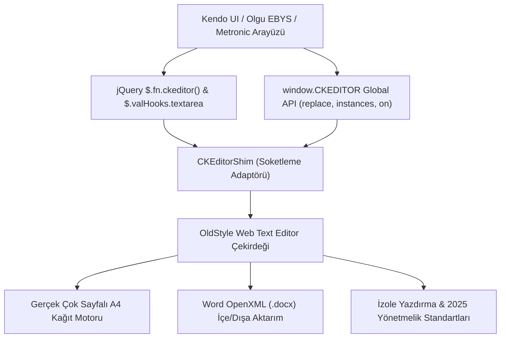

# 🚀 Kendo UI & EBYS için CKEditor 4 Yerine OldStyle Web Text Editor Entegrasyon ve Soketleme (Drop-in Shim) Kılavuzu

Bu kılavuz; **Kendo UI (Grid, Window, Form, MVVM)**, **Olgu EBYS**, **Metronic** ve **jQuery tabanlı kurumsal SPA** mimarilerinde kullanılan eskiyen ve desteği kesilen **CKEditor 4** kütüphanesini, **tek satır uygulama kodu değiştirmeden** modern, A4 sayfalamalı ve Word OpenXML (.docx) uyumlu **OldStyle Web Text Editor** ile nasıl değiştireceğinizi adım adım açıklar.

---

## 📌 İçindekiler
1. [Neden CKEditor 4'ten Geçiş Yapılmalı?](#1-neden-ckeditor-4ten-geçiş-yapılmalı)
2. [Soketleme (Socketing / Shim) Sistemi Mimarisi](#2-soketleme-socketing--shim-sistemi-mimarisi)
3. [Adım Adım Entegrasyon Yöntemleri](#3-adım-adım-entegrasyon-yöntemleri)
   - [Yöntem 1: Doğrudan Script Tag Değişimi (Sıfır Kod Değişikliği)](#yöntem-1-doğrudan-script-tag-değişimi-sıfır-kod-değişikliği)
   - [Yöntem 2: RequireJS / AMD SPA Entegrasyonu (Olgu EBYS)](#yöntem-2-requirejs--amd-spa-entegrasyonu-olgu-ebys)
   - [Yöntem 3: Modern NPM / ES Module Kurulumu](#yöntem-3-modern-npm--es-module-kurulumu)
4. [Kendo UI ile Canlı Kullanım Örnekleri](#4-kendo-ui-ile-canlı-kullanım-örnekleri)
   - [A. Kendo UI Grid Hücre/Popup Editörü](#a-kendo-ui-grid-hücrepopup-editörü)
   - [B. Kendo UI Window (Modal) Belge Düzenleyici](#b-kendo-ui-window-modal-belge-düzenleyici)
   - [C. Kendo MVVM ve Çift Yönlü Form Bağlama](#c-kendo-mvvm-ve-çift-yönlü-form-bağlama)
   - [D. E-İmza ve Form Submit Entegrasyonu](#d-e-imza-ve-form-submit-entegrasyonu)
5. [CKEditor 4 API ve Olay (Event) Uyumluluk Tablosu](#5-ckeditor-4-api-ve-olay-event-uyumluluk-tablosu)
6. [Teknik Üstünlükler ve Karşılaştırma](#6-teknik-üstünlükler-ve-karşılaştırma)
7. [Metronic / Bootstrap Modal & Yazdırma İpuçları](#7-metronic--bootstrap-modal--yazdırma-ipuçları)

---

## 1. Neden CKEditor 4'ten Geçiş Yapılmalı?

Kurumsal kamu ve belediye EBYS (Elektronik Belge Yönetim Sistemi) projelerinde yıllarca kullanılan CKEditor 4 şu kritik darboğazlara sahiptir:

1. **Ömür Sonu (EOL) & Güvenlik:** CKEditor 4 resmi olarak EOL statüsündedir; açık kaynak güvenlik yamaları sonlandırılmıştır ve ticari "LTS" lisansları yüksek maliyetlidir.
2. **Fiziksel Sayfalama Yoksunluğu:** CKEditor içeriği sadece aşağı doğru uzayan sonsuz bir iframe içine yazar. Kullanıcı yazdığı yazının kaçıncı A4 sayfasına taştığını, sayfa sonunun nereye denk geldiğini göremez.
3. **Word (.docx) İçe/Dışa Aktarım Eksikliği:** Word'den metin yapıştırıldığında format bozulur; doğrudan resmi Word belgesi (.docx OpenXML) indirme yeteneği sunmaz.
4. **Resmi Standart Uyumsuzluğu:** 2025 T.C. Cumhurbaşkanlığı Resmî Yazışma Yönetmeliği (1.5 cm / 0.5 cm kenar boşlukları, 18 cm gövde alanı, 1.15 satır aralığı, bağımsız satır hizalama cetveli) için CKEditor'de yerel destek yoktur.
5. **İzole Yazdırma Sorunları:** Portal veya modal pencerelerde `window.print()` tetiklendiğinde CKEditor arka plandaki tüm menüleri, butonları ve sekmeleri de kağıda basar.

**OldStyle Web Text Editor**, sıfır harici bağımlılıkla tam A4 simülasyonu, Word (.docx) aktarımı ve CKEditor 4 soketleme adaptörü sunarak tüm bu sorunları anında çözer.

---

## 2. Soketleme (Socketing / Shim) Sistemi Mimarisi

OldStyle Web Text Editor, bünyesinde yer alan **`CKEditorShim`** ve **`registerJQueryAdapter`** katmanları sayesinde sisteminize CKEditor 4 taklidi yapar. Uygulamanız `CKEDITOR.replace(...)` çağırdığında veya `$('#txtMetin').ckeditor()` çalıştırdığında bu çağrıyı yakalar ve arkasında A4 motorunu başlatır.



### Soketlemenin 3 Temel Direği:

1. **Global `window.CKEDITOR` Nesnesi:**
   - `CKEDITOR.replace(elementOrId, config)`: Belirtilen textarea veya div'i bulur, içine A4 editörünü yerleştirir ve `CKEDITOR.instances[name]` sözlüğüne kaydeder.
   - `CKEDITOR.instances`: Tüm açık editör nesnelerine ID üzerinden erişim sağlar (`CKEDITOR.instances['txtMetin'].getData()`).
   - `CKEDITOR.on('instanceReady')`: Kendo UI pencerelerinin editör yüklendiğinde tetiklediği olayları eksiksiz simüle eder.

2. **jQuery Adaptörü (`$.fn.ckeditor`) ve `$.valHooks.textarea`:**
   - Kendo UI veya jQuery kodunuz `$('#txtMetin').ckeditor()` dediğinde editörü başlatır.
   - **`$.valHooks.textarea` Entegrasyonu:** En kritik yenilik! Kendo Form, `$('form').serialize()` veya `$('#txtMetin').val()` çağrıldığında, `$.valHooks` araya girer ve editörün o anki A4 içeriğini (`getData()`) otomatik döndürür. Form doldurulurken `$('#txtMetin').val(yeniMetin)` dendiğinde editör içeriğini anında günceller (`setData()`).

3. **RequireJS / AMD Modül Entegrasyonu:**
   - Olgu EBYS ve Metronic SPA altyapılarında `define('ckeditor-core')` ve `define('ckeditor')` modüllerini otomatik kaydeder; RequireJS loader hiçbir hata fırlatmadan editörü karşılar.

---

## 3. Adım Adım Entegrasyon Yöntemleri

### Yöntem 1: Doğrudan Script Tag Değişimi (Sıfır Kod Değişikliği)

HTML sayfanızdaki eski CKEditor scriptlerini kaldırıp yerine OldStyle paketini ekleyin:

```html
<!-- ESKİ CKEDITOR 4 KODU (Kaldırın):
<script src="plugins/ckeditor/ckeditor.js"></script>
<script src="plugins/ckeditor/adapters/jquery.js"></script>
-->

<!-- YENİ OLDSTYLE WEB TEXT EDITOR (Ekleyin): -->
<link rel="stylesheet" href="dist/oldstyle-web-texteditor.css">
<script src="dist/oldstyle-web-texteditor.umd.js"></script>
```

> [!TIP]
> Paket yüklendiği anda `window.CKEDITOR` ve `$.fn.ckeditor` otomatik olarak hazır hale gelir. Projenizdeki mevcut JavaScript kodlarında **tek bir harf bile değiştirmeniz gerekmez!**

---

### Yöntem 2: RequireJS / AMD SPA Entegrasyonu (Olgu EBYS)

Eğer projeniz Olgu EBYS veya Metronic gibi RequireJS (`require.config`) mimarisi kullanıyorsa:

```javascript
// require.config konfigürasyonunuzda:
require.config({
    paths: {
        // Eski yol: 'plugins/ckeditor/ckeditor'
        // Yeni yol:
        'ckeditor': 'dist/oldstyle-web-texteditor.umd',
        'ckeditor-core': 'dist/oldstyle-web-texteditor.umd'
    },
    shim: {
        'ckeditor': {
            deps: ['jquery'],
            exports: 'CKEDITOR'
        }
    }
});
```

Sayfa içinde require edildiğinde:
```javascript
require(['jquery', 'ckeditor'], function($) {
    // Eski kodunuz aynen çalışır:
    $('#txtMetin').ckeditor();
});
```

---

### Yöntem 3: Modern NPM / ES Module Kurulumu

```bash
npm install oldstyle-web-texteditor
```

Kodunuzda:
```typescript
import 'oldstyle-web-texteditor/dist/oldstyle-web-texteditor.css';
import { OldStyleWebTextEditor, initCKEditorShim } from 'oldstyle-web-texteditor';

// CKEditor 4 küresel soketini aktif et
initCKEditorShim();

// Artık hem window.CKEDITOR hem de OldStyleWebTextEditor kullanılabilir:
const editor = new OldStyleWebTextEditor(document.getElementById('editorContainer')!, {
    fontFamily: 'Times New Roman',
    fontSize: '12pt',
    lineHeight: '1.15'
});
```

---

## 4. Kendo UI ile Canlı Kullanım Örnekleri

### A. Kendo UI Grid Hücre/Popup Editörü

Kendo Grid üzerinde resmi belge veya açıklama alanlarını düzenlerken A4 Word editörünü kullanmak:

```javascript
$("#belgeGrid").kendoGrid({
    dataSource: {
        data: [
            { Id: 1, Konu: "Personel Görevlendirme", BelgeIcerik: "<p>İlgili personelin görevlendirilmesi hk.</p>" }
        ],
        schema: {
            model: { id: "Id", fields: { BelgeIcerik: { type: "string" } } }
        }
    },
    columns: [
        { field: "Id", width: "50px" },
        { field: "Konu", width: "200px" },
        { 
            field: "BelgeIcerik", 
            title: "Belge Metni", 
            editor: customDocumentEditor, // Özel Editör Fonksiyonu
            template: "#= BelgeIcerik #"
        },
        { command: ["edit"], width: "120px" }
    ],
    editable: "popup"
});

// Kendo Grid Editor Fonksiyonu:
function customDocumentEditor(container, options) {
    // Textarea oluştur ve Kendo Grid Model'ine bağla
    var textarea = $('<textarea name="' + options.field + '" style="height:450px; width:100%;"></textarea>')
        .appendTo(container);

    // CKEditor soketi ile OldStyle A4 Editörünü başlat
    textarea.ckeditor(function() {
        var editorInstance = this; // CKEditorInstanceShim

        // İçerik değiştikçe Kendo modelini güncelle
        editorInstance.on('change', function() {
            options.model.set(options.field, editorInstance.getData());
        });
    });
}
```

---

### B. Kendo UI Window (Modal) Belge Düzenleyici

Resmi yazı düzenleme penceresi açıldığında:

```html
<div id="belgeModalWindow" style="display:none;">
    <div style="padding: 10px;">
        <textarea id="txtResmiYazi" style="width:100%; height:550px;"></textarea>
        <div style="margin-top: 10px; text-align: right;">
            <button id="btnWordIndir" class="k-button">📄 Word (.docx) İndir</button>
            <button id="btnYazdir" class="k-button">🖨️ Yazdır (A4)</button>
            <button id="btnKaydet" class="k-button k-primary">💾 Kaydet</button>
        </div>
    </div>
</div>

<script>
var myWindow = $("#belgeModalWindow").kendoWindow({
    width: "1050px",
    height: "750px",
    title: "T.C. Resmi Yazışma Editörü",
    visible: false,
    modal: true,
    activate: function() {
        // Modal açıldığında editörü soketle
        if (!CKEDITOR.instances['txtResmiYazi']) {
            CKEDITOR.replace('txtResmiYazi', {
                height: 520,
                readOnly: false
            });
        }
    }
}).data("kendoWindow");

// Pencereyi aç ve içerik yükle:
function openBelgeEditor(htmlIcerik) {
    myWindow.center().open();
    var inst = CKEDITOR.instances['txtResmiYazi'];
    if (inst) {
        inst.setData(htmlIcerik);
    }
}

// Word (.docx) İndir Butonu:
$("#btnWordIndir").on("click", function() {
    var inst = CKEDITOR.instances['txtResmiYazi'];
    if (inst && inst.editor) {
        inst.editor.exportWord('Resmi_Yazi_' + Date.now() + '.docx');
    }
});

// Yazdır Butonu (Arka plan çöplerinden tamamen izole):
$("#btnYazdir").on("click", function() {
    var inst = CKEDITOR.instances['txtResmiYazi'];
    if (inst && inst.editor) {
        inst.editor.print();
    }
});

// Kaydet Butonu:
$("#btnKaydet").on("click", function() {
    var inst = CKEDITOR.instances['txtResmiYazi'];
    var guncelHtml = inst.getData();
    console.log("Kaydedilecek HTML:", guncelHtml);
    // $.ajax({ url: '/api/belge/kaydet', data: { html: guncelHtml } });
    myWindow.close();
});
</script>
```

---

### C. Kendo MVVM ve Çift Yönlü Form Bağlama

Kendo MVVM mimarisinde form elemanları `data-bind` ile bağlanır:

```html
<form id="belgeForm">
    <label>Belge Başlığı:</label>
    <input type="text" data-bind="value: baslik" class="k-textbox" />

    <label>Resmi Yazı İçeriği:</label>
    <textarea id="ebysMetin" data-bind="value: icerik" rows="12"></textarea>
</form>

<script>
var viewModel = kendo.observable({
    baslik: "Meclis Kararı Özeti",
    icerik: "<p>Belediye Meclisimizin 10/05/2026 tarihli toplantısında...</p>"
});

kendo.bind($("#belgeForm"), viewModel);

// Editörü soketle
$('#ebysMetin').ckeditor(function() {
    var editor = this;
    editor.on('change', function() {
        // $.valHooks sayesinde viewModel doğrudan güncellenir
        viewModel.set("icerik", editor.getData());
    });
});
</script>
```

---

### D. E-İmza ve Form Submit Entegrasyonu

Belediye ve kamu sistemlerinde (EBYS) belge kaydedilmeden önce e-İmza atılır. Bu aşamada arka plandaki `HTMLTextAreaElement`'in güncel olması şarttır.

OldStyle soketleme sistemi:
1. İçerik her değiştiğinde `inst.updateElement()` fonksiyonunu otomatik çağırır.
2. Form submit edildiğinde `CKEDITOR.instances[id].updateElement()` çalıştırarak `<textarea>` elemanının `value` değerini güncel tutar.
3. E-İmza kütüphaneleri (TÜBİTAK KamuSM, ArkSigner, E-Tuğra vb.) doğrudan `document.getElementById('txtMetin').value` okuduğunda eksiksiz A4 içeriğini alır.

```javascript
function prepareForElectronicSignature() {
    // Tüm açık editörlerin textarea'larını senkronize et
    for (var name in CKEDITOR.instances) {
        CKEDITOR.instances[name].updateElement();
    }

    var imzalanacakMetin = document.getElementById('txtMetin').value;
    return imzalanacakMetin;
}
```

---

## 5. CKEditor 4 API ve Olay (Event) Uyumluluk Tablosu

| CKEditor 4 API | OldStyle Soketleme Karşılığı | Durum |
|---|---|---|
| `CKEDITOR.replace(id, config)` | A4 Editörünü başlatır, `instances[id]` atar | ✅ %100 Uyumlu |
| `CKEDITOR.appendTo(target, config, data)` | Hedef div içine A4 editörü ekler | ✅ %100 Uyumlu |
| `CKEDITOR.instances[name]` | Editör nesnesi referansı | ✅ %100 Uyumlu |
| `editor.getData()` | Temiz, standart A4 HTML çıktısı verir | ✅ %100 Uyumlu |
| `editor.setData(html, cb)` | İçeriği A4 sayfalarına dağıtır, callback çalıştırır | ✅ %100 Uyumlu |
| `editor.insertHtml(html)` | İmleç konumuna serbest HTML/tablo/resim ekler | ✅ %100 Uyumlu |
| `editor.insertText(text)` | İmleç konumuna düz metin ekler | ✅ %100 Uyumlu |
| `editor.updateElement()` | Textarea `.value` alanını senkronize eder | ✅ %100 Uyumlu |
| `editor.destroy()` | DOM ve bellek temizliği yapar | ✅ %100 Uyumlu |
| `editor.checkDirty()` / `resetDirty()` | Değişiklik kontrolü (Dirty flag) | ✅ %100 Uyumlu |
| `editor.setReadOnly(bool)` | Salt okunur modu açar/kapatır | ✅ %100 Uyumlu |
| `editor.on('instanceReady')` | Editör hazır olduğunda tetiklenir | ✅ %100 Uyumlu |
| `editor.on('change')` | Yazı veya biçim değiştiğinde tetiklenir | ✅ %100 Uyumlu |
| `editor.on('dataReady')` | `setData` işlemi tamamlandığında tetiklenir | ✅ %100 Uyumlu |
| `$.fn.ckeditor()` | jQuery eklenti metodu | ✅ %100 Uyumlu |
| `$.fn.ckeditorGet()` | jQuery üzerinden instance alma | ✅ %100 Uyumlu |
| `$.valHooks.textarea` | `$(el).val()` okuma ve yazma kancası | ✅ %100 Uyumlu |

---

## 6. Teknik Üstünlükler ve Karşılaştırma

| Özellik | Standart CKEditor 4 | OldStyle Web Text Editor |
|---|---|---|
| **Fiziksel A4 Sayfalama** | ❌ Yok (Tek parça sonsuz iframe) | ✅ Gerçek Çok Sayfalı A4 (1. sayfa dolunca 2. sayfaya otomatik akış) |
| **Word (.docx OpenXML) İndirme** | ❌ Yok (Yalnızca HTML veya eklentiyle) | ✅ Dahili OpenXML motoru ile birebir Word (.docx) dışa aktarımı |
| **Word (.docx) İçe Aktarma** | ❌ Eklenti gerektirir / Stiller bozulur | ✅ Dahili Mammoth motoru ile sürükle-bırak .docx yükleme |
| **2025 Cumhurbaşkanlığı Standartları** | ❌ Manuel CSS ayarı gerekir | ✅ 1.5 cm / 0.5 cm kenar boşlukları, 18 cm gövde, 1.15 satır aralığı varsayılan |
| **İnteraktif Hizalama Cetveli** | ❌ Yok | ✅ Bağımsız satır hizalama çentikleri ve milimetrik cetvel rozeti |
| **Serbest Kenarlıksız Tablo** | ❌ Sadece standart kenarlıklı tablo | ✅ Kenarlıksız/Kenarlıklı tek tıkla geçiş, fare ile satır/sütun boyutlandırma |
| **İzole Baskı / Yazdırma** | ❌ Arka plandaki portalları ve butonları basar | ✅ Sadece aktif A4 kağıtlarını basan izole `PrintManager` motoru |
| **Dış Bağımlılık (Dependencies)** | ⚠️ Ağır iframe, onlarca eklenti dosyası | ⚡ **Sıfır Dış Bağımlılık** (Tek bir UMD JS ve CSS dosyası) |
| **Lisans Güvencesi** | ❌ EOL / Ticari Lisans Baskısı | 🛡️ **MIT Lisansı (Açık Kaynak & Ücretsiz)** |

---

## 7. Metronic / Bootstrap Modal & Yazdırma İpuçları

1. **Bootstrap Modal İçinde Genişlik:**
   Metronic veya Bootstrap 3/4 modal kullanıyorsanız, editörün modal genişliğine tam oturması için `modal-full` veya `modal-lg` sınıflarını tercih edin:
   ```html
   <div class="modal fade in" id="belgeModal">
       <div class="modal-dialog modal-full">
           <div class="modal-content">
               ...
           </div>
       </div>
   </div>
   ```

2. **Yazdırma Sırasında Modal Çerçevesinin Gizlenmesi:**
   Editörün dahili CSS paketi (`oldstyle-web-texteditor.css`), baskı sırasında `@media print` kuralıyla `.modal-header`, `.modal-footer`, portal sidebar ve navbar elemanlarını otomatik olarak gizler (`display: none !important;`). Sadece basılacak A4 sayfaları yazıcıya gönderilir.

3. **Bul ve Değiştir Z-Index Çakışmaları:**
   Kendo veya Metronic modal pencerelerinde z-index 10050 seviyesindedir. OldStyle Web Text Editor Bul ve Değiştir paneli (`.rye-find-replace-panel`), tüm üst menü ve modal pencerelerin üzerinde (`z-index: 100000`) açılacak şekilde optimize edilmiştir.

---

## 📞 Destek ve Katkı

- **GitHub Repository:** [https://github.com/texteditor-admin/oldstyle-web-texteditor](https://github.com/texteditor-admin/oldstyle-web-texteditor)
- **E-Posta:** `changothramayodhya@gmail.com`
- **Lisans:** MIT (Tüm kamu, özel sektör ve açık kaynak projelerinde ticari ve serbest kullanım garantisi).
